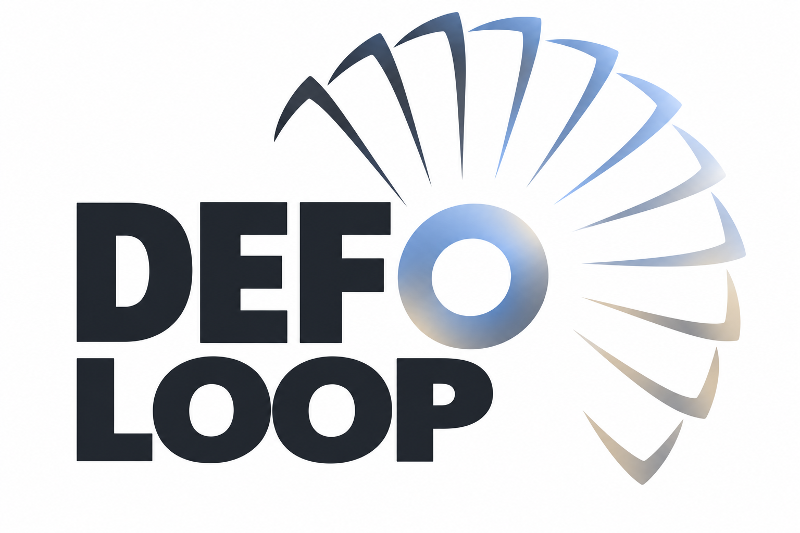
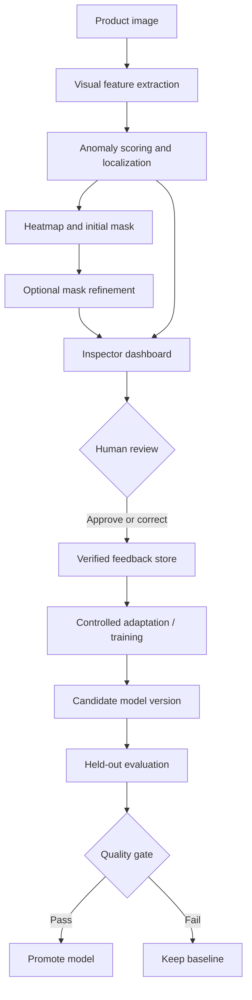

a

  

  <strong>See the defect. Correct the AI. Prove the improvement.</strong> 
  Human-in-the-loop visual quality inspection for manufacturing.

  
  
  
  

  <a href="#overview">Overview</a> ·
  <a href="#inspection-output">Inspection Output</a> ·
  <a href="#architecture">Architecture</a> ·
  <a href="#feedback-loop">Feedback Loop</a> ·
  <a href="#evaluation">Evaluation</a> ·
  <a href="#roadmap">Roadmap</a>

---

## Overview

**DefoLoop** is an AI-powered visual quality inspection project designed to detect manufacturing anomalies, identify their locations, and help inspectors classify and correct defects. Its central idea is simple: **human corrections should become verified learning signals, and their impact should be measured on unseen data.**

Built by a three-engineer team for the [Meta Global AI Developer Hackathon](https://cerebralvalley.ai/e/meta-ai-developer-hackathon), DefoLoop explores how Meta AI technologies can support an inspection workflow that keeps people in control of quality decisions.

> **Project status:** Research prototype in development. The capabilities and workflows below describe the intended MVP unless explicitly identified as implemented. There are no published performance claims yet.

## The Problem

Manual visual inspection can be slow and inconsistent. Automated systems can help, but they may miss subtle defects, flag acceptable products, or outline defective regions inaccurately. A corrected prediction is valuable only if the system can retain that feedback, adapt responsibly, and demonstrate a measurable improvement.

**Our research question:** *Can human-verified corrections reduce missed defects and improve defect localization on previously unseen product images without an unacceptable increase in false alarms?*

## What DefoLoop Aims to Do

| Capability | Expected behavior |
| --- | --- |
| **Detect** | Estimate whether an image contains an anomaly. |
| **Localize** | Produce a pixel-level anomaly score map and predicted defect mask. |
| **Classify** | Suggest a defect category when supported by labeled examples; otherwise flag it as unknown. |
| **Review** | Let inspectors approve, reject, relabel, or redraw AI predictions. |
| **Improve** | Use verified corrections in a controlled model-adaptation process. |
| **Prove** | Compare baseline and updated models on the same held-out test set. |

## Inspection Output

The target inspection interface is organized around four views:

| Input Image | Anomaly Map | Ground Truth | Segmentation Result |
| --- | --- | --- | --- |
| Original product photo | Continuous pixel-level anomaly scores | Benchmark annotation or inspector-verified mask | Predicted defect region and optional threshold contours |

**Important:** A model prediction is **not** ground truth. On an unlabeled production image, ground truth should appear as *Awaiting human verification* until a trusted annotation exists.

The interface will also support a correction workflow in which inspectors can edit a mask, change a label, mark a false positive, or add a missed defect.

## Architecture

The following architecture is **proposed**, not a claim that every component is already implemented:

## Feedback Loop

1. **Inspect:** The current model predicts an anomaly score, location, and any supported defect class.
2. **Verify:** The inspector confirms the result or corrects the mask and label.
3. **Record:** The system stores the source image, original prediction, verified annotation, correction type, and model version.
4. **Adapt:** A controlled training job updates an adaptation component using approved feedback. Corrections do **not** instantly retrain the foundation model.
5. **Evaluate:** The baseline and candidate model are compared on the same untouched test set.
6. **Promote or roll back:** The new model is used only when it meets predefined acceptance criteria.

The goal is a traceable learning system, not a demo that simply saves edited labels.

## Evaluation

We will separate **training data**, **feedback/adaptation data**, **validation data**, and a **final untouched test set**. We will avoid using final test images to choose thresholds or tune the feedback mechanism.

Planned measures include:

- **Defect recall / missed-defect rate:** How often actual defects are detected or missed.
- **False-positive rate:** How often good products are incorrectly flagged.
- **Pixel-level IoU or Dice:** How closely predicted masks match verified masks.
- **Classification F1:** How accurately supported defect types are identified.
- **Latency and inspector time:** Whether the workflow is usable in practice.

We will report measured results, including negative results and trade-offs, rather than assume feedback always helps.

## Datasets

| Dataset | Intended use | Licensing / annotation note |
| --- | --- | --- |
| [VisA](https://registry.opendata.aws/visa/) | Candidate primary benchmark for pixel-level anomaly detection | Image- and pixel-level annotations; CC BY 4.0 |
| [MVTec AD](https://www.mvtec.com/research-teaching/datasets/mvtec-ad) | Research baseline and visual comparison | Pixel-precise defect annotations; **noncommercial** CC BY-NC-SA 4.0 |
| [Iron Ore Conveyor Dataset](https://data.mendeley.com/datasets/s25x2bnshz/1) | Optional industrial conveyor scenario | Primarily video/frames with YOLO and partial annotations; CC BY 4.0 |

We intend to start with **one product category** before expanding. The datasets are research resources and are not redistributed in this repository. Usage remains subject to each dataset's license.

## Technology Choices — Under Review

The team is finalizing the stack based on model quality, compute requirements, development speed, and integration feasibility.

| Layer | Current direction | Decision |
| --- | --- | --- |
| Visual representation / anomaly detection | Evaluate Meta **DINOv3** features with a lightweight anomaly method | Not finalized |
| Segmentation | Evaluate Meta **Segment Anything** for optional mask refinement | Not finalized |
| Defect classification / explanation | Compare supervised classification and optional multimodal assistance | Not finalized |
| Model adaptation | Versioned lightweight learner trained on verified feedback | Design in progress |
| Frontend and annotation editor | Browser-based inspection dashboard | Framework TBD |
| Backend API and storage | Inference, annotation persistence, and training orchestration | Framework/services TBD |
| Experiment tracking | Reproducible evaluations and baseline-to-candidate comparisons | Tooling TBD |

Specific model versions and their licenses, access requirements, and resource needs will be verified before integration. This section will be updated when our engineering decisions are final.

## Deployment — Free-First Approach

We aim to publish a working demo **within free tiers or available hackathon credits where practical**, while keeping the system reproducible locally.

- **Web interface:** Explore free static/frontend hosting.
- **API and storage:** Select services after confirming feature requirements and quotas.
- **Model inference:** Benchmark memory and latency first. Large vision models may require GPU resources or a paid endpoint; free CPU hosting is not assumed sufficient.
- **Training:** Keep experiments separate from the public demo when necessary.
- **Fallback:** If sustained public inference cannot be hosted affordably, provide a transparent recorded demo and reproducible evaluation instructions rather than simulate predictions.

**Hosting provider, public demo URL, and operating budget: To be decided.**

## Roadmap

- [ ] Finalize the PRD, technical architecture, and stack decisions.
- [ ] Select a product category and establish reproducible dataset splits.
- [ ] Produce baseline anomaly scores and real heatmaps.
- [ ] Generate pixel-level masks and build the four-panel inspection view.
- [ ] Implement inspector annotation and correction tools.
- [ ] Persist approved feedback and version model outputs.
- [ ] Implement feedback-driven adaptation.
- [ ] Evaluate before/after performance on untouched images.
- [ ] Deploy a working demo and publish measured results.
- [ ] Prepare the hackathon walkthrough and documentation.

## Team

DefoLoop is built by **three engineers** sharing responsibility for technical leadership, computer vision and experiments, and the full-stack inspection experience.

## Running the Project

Installation steps and verified commands will be published once the initial implementation and dependency versions are committed. We will not publish setup commands that have not been tested.

## References

- [Meta Global AI Developer Hackathon](https://cerebralvalley.ai/e/meta-ai-developer-hackathon)
- [Meta DINOv3](https://ai.meta.com/research/dinov3/)
- [Meta Segment Anything](https://ai.meta.com/sam/)
- [VisA Dataset](https://registry.opendata.aws/visa/)
- [MVTec AD Dataset](https://www.mvtec.com/research-teaching/datasets/mvtec-ad)
- [Iron Ore Conveyor Dataset](https://data.mendeley.com/datasets/s25x2bnshz/1)
- [InspectFlow AI](https://github.com/longlivewama/inspectflow-ai) — related project used for conceptual inspiration, not copied implementation.

## License and Safety

The source-code license has **not yet been selected**. Dataset and model licenses apply separately. This is a research prototype and must not be the sole basis for production-line acceptance or rejection decisions.

---

   
  <strong>DefoLoop</strong> 
  <em>See the defect. Correct the AI. Prove the improvement.</em>

