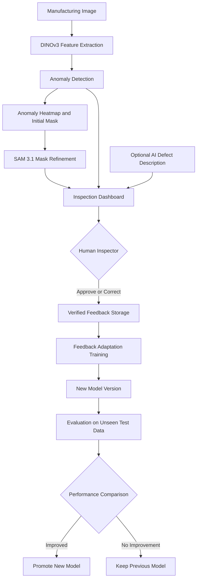

# DefoLoop

### See the defect. Correct the AI. Prove the improvement.

**Human-in-the-loop visual quality inspection for manufacturing.**

DefoLoop is an AI-powered manufacturing quality inspection system designed to detect product anomalies, localize defects at the pixel level, classify defect types, and improve its predictions through verified human feedback.

**Built for:** [Meta Global AI Developer Hackathon](https://cerebralvalley.ai/e/meta-ai-developer-hackathon)  
**Status:** In Development  
**Team:** 3 Engineers

---

## The Problem

Visual quality inspection is essential in manufacturing, but traditional manual inspection can be slow, inconsistent, and vulnerable to human error.

AI-powered inspection systems can accelerate defect detection, but they also face significant challenges:

- Missing subtle or previously unseen defects.
- Incorrectly classifying normal products as defective.
- Producing inaccurate defect boundaries.
- Struggling to adapt to new defect patterns.
- Providing limited opportunities for inspectors to correct mistakes.

Most importantly, correcting an AI prediction does not necessarily mean the model learns from that correction.

**DefoLoop aims to bridge this gap by introducing a measurable human-in-the-loop learning system.**

## Our Solution

DefoLoop combines computer vision, segmentation, anomaly detection, and human feedback into one inspection workflow.

The system is designed to:

1. Analyze manufacturing product images.
2. Detect potential anomalies using visual AI models.
3. Generate pixel-level anomaly heatmaps.
4. Identify and segment defective regions.
5. Suggest defect categories.
6. Allow human inspectors to verify and correct predictions.
7. Use verified corrections to update an adaptation model.
8. Evaluate whether those updates improve performance on unseen data.

### Our Core Research Question

**Can verified human corrections improve defect detection and localization on previously unseen manufacturing images while maintaining an acceptable false-positive rate?**

Our objective is not merely to build another defect detection interface. We want to experimentally demonstrate whether human feedback makes industrial AI inspection more reliable.

---

## Core Features

### 1. AI-Powered Anomaly Detection

Analyze manufacturing images to identify regions that differ from expected normal product appearances.

The anomaly detection pipeline will produce image-level anomaly scores and pixel-level anomaly maps.

### 2. Pixel-Level Defect Localization

Visualize potentially defective regions through continuous anomaly heatmaps and predicted segmentation masks.

### 3. Defect Classification

Suggest categories for detected defects where the available model and labeled examples support reliable classification.

Low-confidence or unfamiliar defects may be classified as `unknown defect` and referred to an inspector.

### 4. Human-in-the-Loop Inspection

Inspectors will be able to:

- Approve correct predictions.
- Correct inaccurate segmentation boundaries.
- Mark false-positive detections.
- Identify defects missed by the model.
- Modify incorrectly predicted defect categories.

### 5. Feedback-Driven Model Improvement

Verified inspector corrections will be stored as labeled feedback.

The system will use approved feedback to update a lightweight learning component, creating new versioned models that can be evaluated against the original baseline.

### 6. Experimental Performance Evaluation

Compare the original model and feedback-adapted models using reproducible experiments on previously unseen test images.

---

## Expected Inspection Output

Our target visualization contains four complementary panels.

| Panel | Description |
|---|---|
| **Input Image** | Original image of the inspected manufacturing product. |
| **Anomaly Map** | Pixel-level heatmap representing estimated anomaly scores. |
| **Ground Truth** | Verified defect segmentation mask supplied by a dataset or human inspector. |
| **Segmentation Result** | Model-generated defect mask or threshold-based segmentation visualization. |

Ground truth must represent independently verified annotations, not simply the model's own prediction.

For images that have not yet been reviewed or labeled, the ground-truth panel will indicate that verification is pending.

---

## Proposed System Architecture

The system combines Meta's computer vision technologies with a feedback-driven adaptation pipeline.

### AI Technologies

**Meta DINOv3**

Used as a visual feature extractor for anomaly detection and patch-level feature representations.

DINOv3 provides image representations rather than a ready-made manufacturing defect detector. DefoLoop will implement its own anomaly scoring and learning components on top.

**Meta SAM 3.1**

Used for point-guided or box-guided segmentation and refinement of suspected defect regions.

SAM does not independently determine whether a region is defective; it supports the localization process.

**Meta Muse Spark**

Explored as an optional multimodal component for defect descriptions, category suggestions, and inspector-facing explanations, subject to API availability and model suitability.

**Human Feedback Adaptation**

A lightweight trainable component built using verified inspection examples, with experiment tracking and model versioning.

---

## Proposed Technology Stack

| Layer | Technology |
|---|---|
| Computer Vision | Meta DINOv3 |
| Segmentation | Meta SAM 3.1 |
| Multimodal Reasoning | Meta Muse Spark (optional) |
| Deep Learning | PyTorch |
| Backend | Python, FastAPI |
| Frontend | React / Next.js |
| Database | PostgreSQL (proposed) |
| Model Evaluation | scikit-learn, NumPy |
| Image Processing | OpenCV |
| Visualization | Interactive heatmaps and segmentation overlays |
| Deployment | To be determined |

The technology stack may evolve as we benchmark inference performance, model availability, and deployment constraints.

---

## Human Feedback Loop

Human feedback is the central innovation of DefoLoop.

### Stage 1: Initial Inspection

The AI analyzes the uploaded product image and produces an anomaly map, defect mask, and optional classification.

### Stage 2: Human Verification

The inspector reviews the result and can approve it or correct inaccurate predictions.

### Stage 3: Feedback Collection

Verified corrections are saved alongside the relevant image, predicted output, correction type, and model version.

### Stage 4: Model Adaptation

Approved feedback is used to update a lightweight anomaly scoring or classification component.

Training is performed as an explicit, controlled process rather than automatically retraining the model after every correction.

### Stage 5: Performance Evaluation

The baseline and updated model are evaluated using the same held-out test images.

The updated model is promoted only when its measured performance satisfies predefined criteria.

---

## Datasets

We plan to evaluate DefoLoop using publicly available industrial inspection datasets.

### VisA — Primary Dataset

[Visual Anomaly Dataset](https://registry.opendata.aws/visa/)

VisA contains industrial product images, normal and anomalous examples, and pixel-level annotations.

It is our proposed primary dataset for initial development and evaluation.

### MVTec AD — Research Benchmark

[MVTec Anomaly Detection Dataset](https://www.mvtec.com/research-teaching/datasets/mvtec-ad)

MVTec AD is an established benchmark for industrial visual anomaly detection and localization.

It includes multiple product categories with annotated defect regions.

**License:** CC BY-NC-SA 4.0. The dataset is restricted to noncommercial use under its license.

### Iron Ore Conveyor Dataset

[Mendeley Dataset](https://data.mendeley.com/datasets/s25x2bnshz/1)

A secondary dataset that may support future experiments involving conveyor environments and industrial object monitoring.

Its annotations are not equivalent to a complete pixel-level manufacturing defect segmentation benchmark.

### Dataset Strategy

We will initially focus on one product category to establish a reliable baseline and evaluate the feedback loop before expanding to additional categories.

Dataset and model licensing terms will be respected throughout development.

---

## Evaluation Methodology

We want to prove that inspector feedback improves model performance rather than simply demonstrate that corrections can be saved.

### Baseline Experiment

Evaluate the initial anomaly detection and localization model on held-out test data.

### Feedback Experiment

Collect verified corrections from a separate feedback dataset and use them to update the adaptation model.

### Final Comparison

Evaluate both model versions on the same untouched test images.

### Evaluation Metrics

| Metric | Purpose |
|---|---|
| Defect Recall | Percentage of real defective images correctly detected. |
| Missed-Defect Rate | Percentage of defective images incorrectly classified as normal. |
| Precision | Reliability of positive defect predictions. |
| False-Positive Rate | Frequency of normal products incorrectly flagged. |
| F1 Score | Balance between precision and recall. |
| Pixel IoU | Overlap between predicted and verified defect regions. |
| Dice Score | Similarity between predicted and verified segmentation masks. |
| Inference Latency | Time required to analyze an image. |

Training, feedback collection, threshold calibration, and final testing will use appropriately separated datasets to reduce data leakage.

We will publish measured experimental outcomes, including unsuccessful adaptation experiments, rather than assume that feedback always improves performance.

---

## Development Roadmap

### Phase 1 — Research and Foundation

- [ ] Finalize technical requirements and architecture.
- [ ] Select the initial dataset and product category.
- [ ] Establish reproducible dataset splits.
- [ ] Set up the backend and ML environment.
- [ ] Implement the initial anomaly detection baseline.

### Phase 2 — Visual Inspection System

- [ ] Generate real anomaly heatmaps.
- [ ] Produce pixel-level predicted segmentation masks.
- [ ] Implement the four-panel inspection interface.
- [ ] Integrate optional SAM-assisted segmentation.
- [ ] Implement image upload and inference APIs.

### Phase 3 — Human Feedback

- [ ] Build the inspector review interface.
- [ ] Implement interactive defect-mask corrections.
- [ ] Store verified annotations and feedback history.
- [ ] Implement model versioning.
- [ ] Train a feedback-driven adaptation component.

### Phase 4 — Evaluation

- [ ] Evaluate baseline performance.
- [ ] Evaluate adapted model performance.
- [ ] Compare missed-defect rates and false positives.
- [ ] Measure segmentation accuracy.
- [ ] Document limitations and experimental results.

### Phase 5 — Hackathon Demonstration

- [ ] Prepare a working end-to-end demonstration.
- [ ] Deploy the inspection application.
- [ ] Document the model architecture.
- [ ] Publish reproducible evaluation results.
- [ ] Record a demonstration video.
- [ ] Complete the hackathon submission.

---

## Project Team

DefoLoop is being developed by a team of three engineers.

| Role | Responsibilities |
|---|---|
| Technical Lead | Architecture, integration, experimental design, deployment, and delivery |
| ML / Computer Vision Engineer | Anomaly detection, segmentation, feedback adaptation, and model evaluation |
| Full-Stack Engineer | Inspection interface, annotation tools, backend integration, and feedback persistence |

---

## Project Status

**Current Stage: Planning and Early Development**

DefoLoop is being built for the Meta Global AI Developer Hackathon.

The model pipeline, inspection interface, feedback system, and evaluation experiments are under development.

Local installation instructions, API documentation, deployment details, and demonstrated results will be added as working components become available.

**Important:** DefoLoop is currently a research prototype and should not be used as the sole authority for real-world production acceptance or rejection decisions.

---

## References and Acknowledgments

- [Meta DINOv3](https://ai.meta.com/research/dinov3)
- [Meta SAM Documentation](https://dev.meta.ai/docs/sam/overview)
- [Meta Global AI Developer Hackathon](https://cerebralvalley.ai/e/meta-ai-developer-hackathon)
- [VisA Dataset](https://registry.opendata.aws/visa/)
- [MVTec AD Dataset](https://www.mvtec.com/research-teaching/datasets/mvtec-ad)
- [Mendeley Industrial Dataset](https://data.mendeley.com/datasets/s25x2bnshz/1)
- [InspectFlow AI](https://github.com/longlivewama/inspectflow-ai) — related project used for conceptual inspiration.

DefoLoop is an independent hackathon project, not an official Meta product. Third-party technologies and datasets remain subject to their respective licenses.

---

### DefoLoop — Better inspections through measurable human feedback.

*See the defect. Correct the AI. Prove the improvement.*
