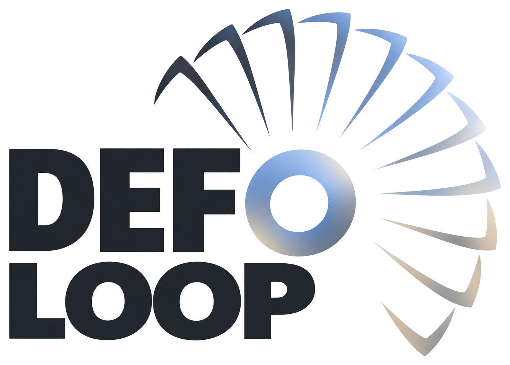
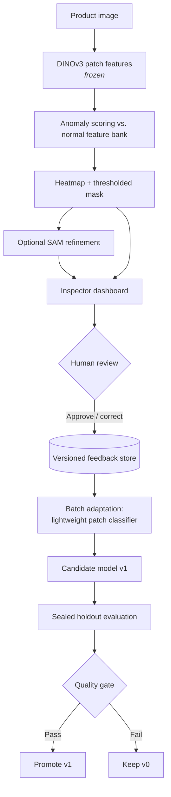

<div align="center">

<picture>
  <source media="(prefers-color-scheme: dark)" srcset="assets/logo-dark.png">
  <source media="(prefers-color-scheme: light)" srcset="assets/logo-light.png">
  
</picture>

<h3>See the defect. Correct the AI. Prove the improvement.</h3>

<p>Human-in-the-loop visual quality inspection for manufacturing.<br>
Inspector corrections become versioned training signal, and every model update is measured on unseen images.</p>

<p>
  <a href="https://cerebralvalley.ai/e/meta-ai-developer-hackathon"></a>
  
  <a href="docs/prd.md"></a>
  
  <a href="https://github.com/Muhammed-Farrag/DefoLoop/commits/main"></a>
</p>

<p>
  <a href="#overview">Overview</a> •
  <a href="#how-it-works">How It Works</a> •
  <a href="#architecture">Architecture</a> •
  <a href="#evaluation">Evaluation</a> •
  <a href="#tech-stack">Tech Stack</a> •
  <a href="#roadmap">Roadmap</a> •
  <a href="docs/prd.md">Docs</a>
</p>

</div>

---

> [!NOTE]
> **DefoLoop is a research prototype under active development.** This README describes the planned MVP; nothing below is a claim of a trained or deployed system. We have not published any performance results yet.

## Overview

**DefoLoop** detects anomalies in manufacturing images, shows where they are at the pixel level, and lets a human inspector approve or correct each prediction. The corrections feed a controlled, versioned model update. The baseline and updated models are then compared on the **same sealed holdout set**, so any improvement is measured rather than assumed.

A three-engineer team is building it for the [Meta Global AI Developer Hackathon](https://cerebralvalley.ai/e/meta-ai-developer-hackathon) (26 Oct – 4 Nov 2026).

**Research question:** *Can human-verified corrections reduce missed defects and improve defect localization on previously unseen product images, without an unacceptable increase in false alarms?*

### Key Features

| Capability | Planned behavior |
| --- | --- |
| **Detect** | Image-level anomaly score with a calibrated decision threshold |
| **Localize** | Continuous pixel-level anomaly map and binary defect mask |
| **Classify** | Provisional defect label, or `unknown defect` when the evidence is weak |
| **Review** | Approve, reject, relabel, paint or erase masks, and flag misses and false alarms |
| **Improve** | Train a lightweight adapter on verified corrections and produce an immutable new model version |
| **Prove** | Paired v0 vs. v1 metrics on untouched holdout images, with denominators shown |

## How It Works

### Four-panel inspection view

| Input Image | Anomaly Map | Ground Truth | Segmentation Result |
| --- | --- | --- | --- |
| Original full-resolution image | Continuous heatmap with a threshold slider | Benchmark mask or inspector-verified correction | Thresholded predicted mask, area, class, and model version |

### Feedback loop

1. **Inspect**: model v0 predicts an anomaly score, a heatmap, a mask, and a provisional label.
2. **Verify**: the inspector confirms the result or corrects the mask and label.
3. **Record**: the source image, original prediction, corrected mask, review type, and model version are stored immutably.
4. **Adapt**: an explicit batch job trains a lightweight classifier on approved feedback. The foundation model stays frozen.
5. **Evaluate**: v0 and v1 are compared on the same sealed holdout set.
6. **Promote or roll back**: a new version is promoted only if it passes predefined acceptance criteria.

## Architecture

The architecture below is **proposed**. See [PRD §5](docs/prd.md#5-ai-architecture-and-honest-capability-boundaries) for the full design and capability boundaries.



## Evaluation

The data is split into **train / calibration / feedback / holdout** sets, and the splits are frozen and hashed before any model tuning. Final test images are never used to choose thresholds or feedback examples.

| Metric | What it tells us |
| --- | --- |
| **Defect recall** (TP / all defective) | How many real defects are caught |
| **Missed-defect rate** (FN / all defective) | How many real defects slip through |
| **False-positive rate** (FP / all normal) | How often good products are flagged |
| **Pixel IoU / Dice / AUROC** | How well predicted masks match verified masks |
| **Latency** | Whether the workflow is usable in practice |

We will report raw counts with every metric, include uncertainty estimates where the sample size allows, and publish negative results as well as positive ones. The full protocol is in [PRD §8](docs/prd.md#8-experimental-protocol--core-differentiation).

## Datasets

| Dataset | Role | License |
| --- | --- | --- |
| [VisA](https://registry.opendata.aws/visa/) | **Primary**: one PCB category with pixel-level masks | CC BY 4.0 |
| [MVTec AD](https://www.mvtec.com/research-teaching/datasets/mvtec-ad) | Optional reference benchmark | CC BY-NC-SA 4.0 (**noncommercial**) |
| [Iron Ore Conveyor](https://data.mendeley.com/datasets/s25x2bnshz/1) | Stretch goal: video / domain-shift demo | CC BY 4.0 |

Datasets are **not redistributed** in this repository. Each one is subject to its own license.

## Tech Stack

The stack is proposed and will be finalized during the hackathon (see [PRD §7](docs/prd.md#7-minimal-api-and-data-contracts)).

| Layer | Choice |
| --- | --- |
| Anomaly features | Meta **DINOv3** (frozen) with PatchCore-style nearest-neighbor scoring |
| Mask refinement | Meta **SAM 3.1** (optional, gated by measured improvement) |
| Provisional labels | Meta **Muse Spark** with a closed vocabulary (assistive only, never ground truth) |
| Adaptation | Lightweight patch classifier (PyTorch / scikit-learn) |
| Backend | Python, FastAPI, SQLite |
| Frontend | React / Next.js with a canvas mask editor |

## Roadmap

- [x] Product requirements document ([v0.1](docs/prd.md))
- [ ] Dataset manifest and frozen, hashed splits
- [ ] Baseline DINOv3 heatmaps and pixel masks
- [ ] Four-panel inspection view
- [ ] Mask correction editor with save and reload
- [ ] Versioned feedback store and batch adaptation job
- [ ] Sealed v0 / v1 holdout evaluation
- [ ] Before/after dashboard and recorded demo
- [ ] SAM / Muse Spark integrations (stretch)

## Getting Started

Setup instructions will be added once the first implementation and pinned dependencies are committed. We won't publish commands we haven't tested.

## Project Structure

```text
DefoLoop/
├── assets/       # Logo and brand assets
├── docs/
│   └── prd.md    # Product requirements document
└── README.md
```

## Contributing

DefoLoop is developed by a three-person team:

- `main` is protected. Work on feature branches and merge through reviewed pull requests.
- Don't commit dataset images, model weights, or API keys.
- API and evaluation JSON schemas are frozen. Any change to them needs team review.

## Acknowledgements

- [Meta DINOv3](https://ai.meta.com/blog/dinov3-self-supervised-vision-model/), [Segment Anything](https://ai.meta.com/sam/), and the [Meta Model API](https://dev.meta.ai/docs/sam/overview)
- [VisA](https://github.com/amazon-science/spot-diff), [MVTec AD](https://www.mvtec.com/research-teaching/datasets/mvtec-ad), and the [Mendeley Iron Ore Conveyor](https://data.mendeley.com/datasets/s25x2bnshz/1) dataset authors
- [InspectFlow AI](https://github.com/longlivewama/inspectflow-ai), used as an architectural reference only. No code was copied.

## License

The source-code license has **not been selected yet**. Dataset and model licenses (including Meta's DINOv3 License) apply separately.

---

<div align="center">
  <picture>
    <source media="(prefers-color-scheme: dark)" srcset="assets/logo-dark.png">
    
  </picture>
  <br>
  <sub>Built for the Meta Global AI Developer Hackathon 2026</sub>
</div>
